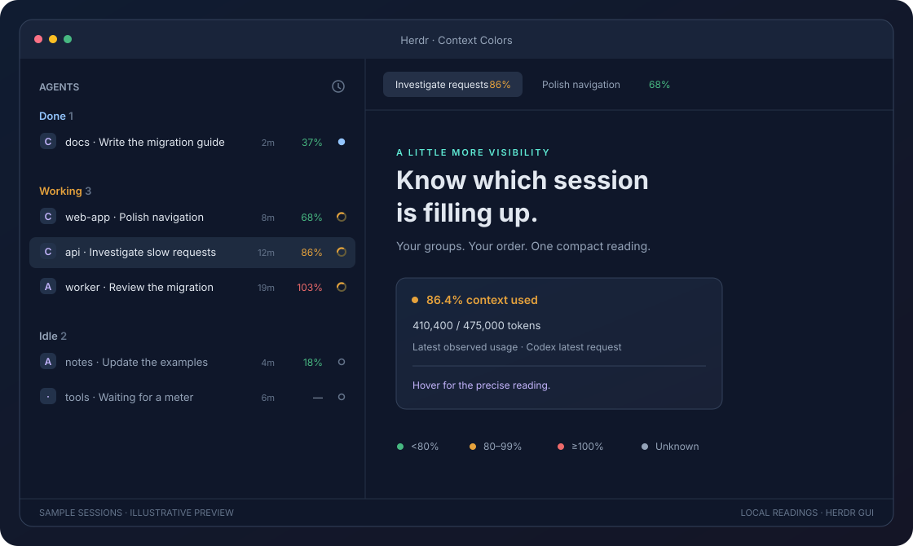

<div align="center">

# herdr-context

**Your agents’ context, at a glance.**

Small, colorful context meters for Herdr’s agent list and tabs.
Spot a full session while keeping your usual groups, pins, and order.

[](https://github.com/lucasscariot/herdr-context/actions/workflows/checks.yml)
[](https://herdr.dev)
[](https://www.python.org/downloads/)
[](#how-it-works)

</div>



*Illustrative preview with sample agents. The colors, compact percentages, and hover details follow the plugin’s display rules.*

## What you get

- **A quick visual scan:** green, orange, and red readings reveal which sessions are filling up.
- **A tidy agent list:** whole percentages align in a fixed 30px column, leaving room for names. Hover for the precise reading.
- **Useful tab indicators:** each tab shows its highest agent reading, including Herdr Core child agents.
- **Your existing setup:** Needs you, Done, Working, and Idle sections keep their usual ordering, pins, and controls.
- **Honest unknowns:** missing, stale, or ambiguous readings show grey. A tab with incomplete coverage cannot claim green.
- **Local collection:** existing terminal meters and local usage records supply the readings. No model API calls or account credentials are needed.

## Quickstart

You need Git, Python **3.9+**, and the **Herdr GUI with Herdr Core** installed.
Keep Herdr open in a layout using its standard agent list and tab bar, such as the default Herdr layout.

```sh
git clone https://github.com/lucasscariot/herdr-context.git
cd herdr-context
python3 install.py
```

The installer validates the mods, copies your current layout, and switches to
`<layout>-context`. Existing panels, appearance settings, status timestamps, and
panel preferences are preserved. It also prints the command to return to your
previous layout. Name conflicts are rejected before installation.

Tested with Herdr GUI **0.1.15 on Apple Silicon macOS**. Linux and Windows are
unverified. The terminal-only Herdr TUI is not required.

## Read the colors

| Reading | Meaning |
| --- | --- |
| 🟢 **Green** | Below 80% of the context window |
| 🟠 **Orange** | At least 80%, below 100% |
| 🔴 **Red** | At least 100% |
| **Grey —** | No reliable reading is currently available |

Colors use the exact reading. The compact label rounds down, so `79.9%` stays
green and displays `79%`; the tooltip keeps the decimal. Hover also reveals
token counts when available and where the reading came from.

Context usage describes the latest observed working window. Weekly quota is a
separate measure: an agent can compact below 100% and still consume quota. The
plugin displays readings and leaves agent execution in your control.

## Supported agents

| Agent | Reading source |
| --- | --- |
| **Codex** | Latest request usage from its matched local session, with a readable terminal meter as fallback |
| **Claude Code** | Existing status line exposing `context N% (used/capacity)` |
| **Cursor** | Context percentage in the CLI footer |
| **Other agents** | Grey until a supported meter is available; this currently includes Grok |

Remote terminals need a readable supported footer. Local Codex records are never
used to guess a remote session’s context. Child agents appear only when exposed
as Herdr Core terminals.

## How it works

One small collector reads current terminal screens through `hc` and local Codex
session metadata. It refreshes every ten seconds, with bounded reads and no
overlapping collection cycles. A reading expires after 35 seconds or a session
identity change.

Codex readings use the **latest request**, rather than accumulated billed tokens.
Session matching prefers an open file or lock, then an exact unique session name;
ambiguous names stay grey. A compaction clears the previous reading until fresh
usage arrives.

Only derived usage metadata passes to the UI. The collector makes no network
requests, reads no credentials, sends no terminal input, and changes no agent
configuration.

[Read the implementation and compatibility notes →](docs/usage.md)

## Restore your previous layout

Use the exact command printed by the installer. For a previous layout named `main`:

```sh
herdr-app do layout.switch '{"name":"main"}'
```

Switching layouts leaves your terminals running. The installed mods are personal
copies, so app updates do not overwrite them; future Herdr changes may require
updating the copies or the meter parser.

## Development

Node.js is needed only for the tests. No package installation or API keys are required.

```sh
npm test
herdr-app check "$PWD/mods/context-agents"
herdr-app check "$PWD/mods/context-tabs"
```

The portable tests cover context thresholds, stale readings, compaction, session
matching, layout preservation, and agent grouping and ordering. Native checks
need Herdr installed; CI runs the portable tests.

To regenerate the README illustration from its sample data:

```sh
python3 docs/render_preview.py
```

Bug reports and improvements are welcome through
[issues](https://github.com/lucasscariot/herdr-context/issues) and pull requests.
Include the Herdr version, agent, OS, and whether the reading is missing or incorrect.

## Credits

Built for [Herdr](https://herdr.dev). The two UI mods are personal clones of the
agent list and tab bar shipped with Herdr GUI 0.1.15, with context annotations
added here. [RECIPE.md](RECIPE.md) describes the interface and behavior for rebuilding it.
