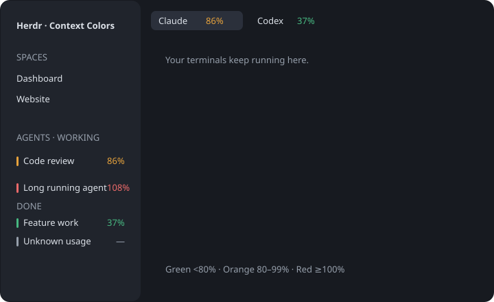

# Herdr Context Colors

Subtle context meters beside Herdr's agents and tab names: green below 80%, orange from 80% to below 100%, red at 100% or more. Grey means no reliable reading is available. Herdr's existing Needs you, Done, Working, and Idle groups, sort preference, pins, navigation order, and tab order are preserved.



## Install

Requires the Herdr GUI (tested with 0.1.15), Herdr Core, Python 3.9+, and Node.js for tests only. The Herdr TUI is not needed.

With Herdr running in a layout containing the standard `agents` and `tabs` mods:

```sh
python3 install.py
```

The installer validates both mods, adds `context-agents` and `context-tabs`, and activates a copy of the current layout named `<layout>-context`. The previous layout, existing mods, other panels, and running terminals remain available. Existing status timestamps and panel preferences are copied when the new mod has no state. Name conflicts are rejected before installation. Pass `--name my-layout` to choose another layout name.

To return to the previous layout, use the command printed by the installer, for example:

```sh
herdr-app do layout.switch '{"name":"main-insights"}'
```

## Readings

- Agent rows retain their status indicators and gain a right-aligned colored percentage in a fixed 30px column. Whole percentages are rounded down so the label stays consistent with the exact green/orange/red thresholds; hover for the precise reading, token counts when available, and its source. Unknown readings reserve the same space, and collapsed groups use the same annotation. The narrow sidebar rail retains a 3px colored mark.
- Tabs show the highest context use among their agents and any Herdr Core child agents. Incomplete coverage cannot produce a green tab; a known orange/red reading still warns, with missing coverage explained in the tooltip.
- The collector refreshes every 10 seconds, with at most four concurrent reads and no overlapping collection cycles. Readings expire after 35 seconds or a session/process change.
- Codex: match its open session file/lock, excluding guardian sessions. When files are not held open, use its exact, unique OSC session name. Duplicate names are unknown. Read the latest request's `last_token_usage.total_tokens / model_context_window`, never session-wide cumulative totals. A compaction invalidates the previous reading until a new usage event arrives. Local database access is read-only and log reads are bounded to the last 4 MiB.
- Claude Code: read the current status-line meter, including its displayed context percentage and token denominator. An existing status line must expose `context N% (used/capacity)`; this plugin does not install or change a status line. Displayed counts may be rounded.
- Cursor: read the context percentage in its current CLI footer (`model · N% · files edited`). [Cursor's CLI documentation](https://cursor.com/docs/cli/using) describes its context controls.
- Other providers, missing or ambiguous data, and unsupported remote Codex session formats show grey. This includes Grok on the tested setup. Core child agents can be annotated; agents internal to another tool are only visible if that tool exposes them as Core terminals.

Context is the latest observed working window, not weekly quota, a bill, or a prediction of future spending. Agents can compact below 100% and can continue consuming quota with a small context. The plugin does not interrupt or compact agents.

## Access and implementation

The collector runs local Python and reads terminal metadata, current screens through `hc read --lines 0`, and Codex's local session metadata/usage records. On macOS, `lsof` maps a Codex process to its own open session. It makes no network or model API calls, reads no credentials, sends no terminal input, and changes no agent configuration. Only derived usage metadata is shared between the two mods; terminal screen text is not stored or sent to the UI.

The two UI mods are clones of Herdr's shipped `agents` and `tabs` mods from GUI 0.1.15. Their ordering behavior is retained. Herdr replaces shipped mods during upgrades; these clones are personal files and survive restarts. A future Herdr update may require refreshing the clones or adapting the usage parser.

## Validate

```sh
npm test
herdr-app check "$PWD/mods/context-agents"
herdr-app check "$PWD/mods/context-tabs"
```

Tests cover threshold boundaries, missing/expired data, compaction, cumulative versus current tokens, duplicate session names, remote isolation, layout preservation, and a rendered agent-list regression proving that highlights cannot reorder status groups or pinned agents. Live validation also checks actual agent rows, tab annotations, and Herdr's reported errors.
