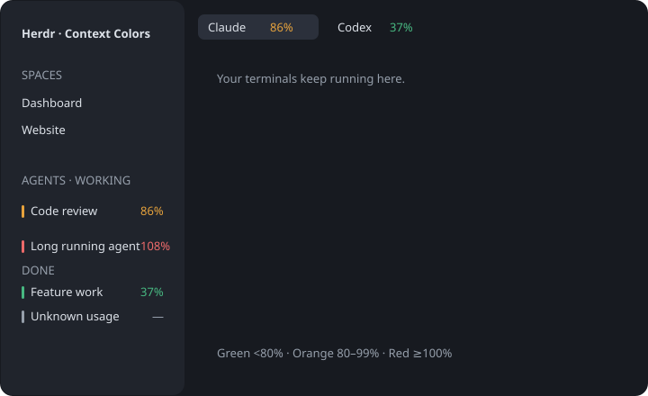

# Context Colors

Add small context-use indicators to Herdr's agent list and tab bar while preserving its existing ordering and status groups.

## What you see

Agent rows keep their usual icons, names, elapsed times, status marks, and Needs you/Done/Working/Idle sections. A right-aligned 10.5px whole percentage occupies a fixed 30px column before the status mark. Remove the redundant colored bar and padding from expanded rows. Unknown readings show a dash in the same column; very large values show `999+` to stay within it. Only the collapsed sidebar rail uses a 3×10px colored mark. Tab pills get the same percentage column for their highest observed agent context usage. Colors are green `#47b881` below 80%, orange `#e6a23c` from 80% to below 100%, red `#ed6a6a` from 100%, and theme dim for unknown usage. The rest of the window follows the existing layout and theme.

## How it behaves

All existing click, pin, fold, status, and navigation behavior remains. There is no context-based sorting. Working agents retain their spinner; blocked, done, and idle states retain their normal status marks. Whole percentages round down so 79.9% remains visibly green and 99.9% remains orange; hovering shows the precise reading, source, and available token counts. Collapsed groups show the highest reading. A tab containing an unknown agent never claims fully green coverage. Data refreshes every ten seconds and expires after 35 seconds or an identity change.

## Built from

Clone the shipped agents and tabs mods and add a badge helper. Preserve the original `agents.sort` shared preference and sorting code. A Python collector reads `hc` screen snapshots and read-only Codex session metadata. One monitor lives in the agents mod; tabs read its derived shared snapshot. Follow `terminals()` parent links to include Core child agents in a tab's highest reading. Clone the active layout with `layout.clone`, replace only the agents/tabs content references, and keep all other mods, tree nodes, appearance choices, and clicks.

## Watch out

Never divide cumulative billed tokens by the context window. Never choose the newest transcript in a shared project folder. Codex activity glyphs and Action Required title prefixes must not look like new sessions. Duplicate session names are unknown; guardian sessions are excluded. Clear prior counts after compaction. Grey is distinct from zero. Claude needs an existing readable status-line meter. Grok has no supported meter in the tested setup. Remote Codex cannot be matched against a local database. Do not modify shipped mods or run agent commands to discover their usage. Do not publish live screenshots containing terminal content; the included preview is schematic.

## Done when

Both mods pass `herdr-app check`; threshold, freshness, session association, compaction, layout-preservation, and agent-order tests pass; live rows and tabs show percentages; original status groups/order remain; Herdr reports no errors; the previous layout is one switch away.
